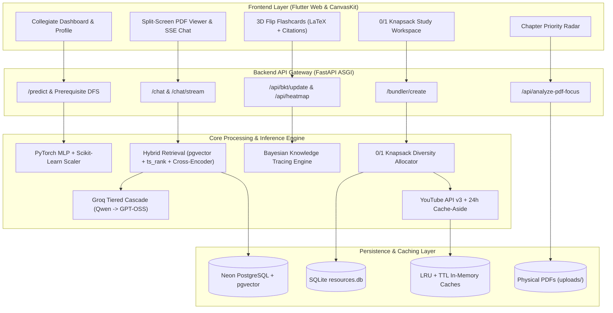
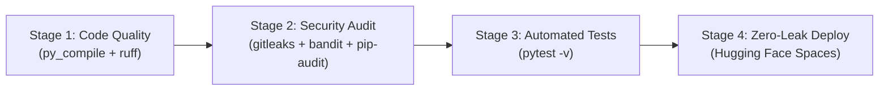

# 🎓 University AI Academic Suite & Pedagogical Recommender
## Comprehensive System Architecture & Engineering Documentation

> **Target Audience**: Fellowship & Internship Technical Interviews (e.g., Major League Hacking, Software Engineering / AI Engineer Internships), Code Reviews, and Project Portfolio Presentations.

---

## 📑 Table of Contents
1. [Executive Summary & High-Level Pitch](#1-executive-summary--high-level-pitch)
2. [Problem Statement & Core Objectives](#2-problem-statement--core-objectives)
3. [The Engineering Solution](#3-the-engineering-solution)
4. [Key Features Breakdown](#4-key-features-breakdown)
5. [System Architecture & Data Flow](#5-system-architecture--data-flow)
6. [Core Algorithms & Machine Learning Deep Dive](#6-core-algorithms--machine-learning-deep-dive)
7. [Tech Stack & Justifications](#7-tech-stack--justifications)
8. [Repository & Codebase Structure](#8-repository--codebase-structure)
9. [API Architecture & Endpoint Reference](#9-api-architecture--endpoint-reference)
10. [Automated Testing & Quality Assurance](#10-automated-testing--quality-assurance)
11. [DevOps, Security & CI/CD Pipeline](#11-devops-security--cicd-pipeline)
12. [Interview Cheatsheet (MLH / Fellowship Q&A)](#12-interview-cheatsheet-mlh--fellowship-qa)

---

## 1. Executive Summary & High-Level Pitch

**One-Sentence Summary**:
An enterprise-grade, full-stack pedagogical assistant and academic intervention platform that predicts student academic failure risks using PyTorch, generates optimal multi-modal study sessions using a 0/1 Knapsack algorithm, and provides real-time, hallucination-resistant textbook dialogue via a Hybrid RAG pipeline with LaTeX KaTeX rendering.

**The Elevator Pitch (30-Second Interview Response)**:
> *"Most Learning Management Systems (like Canvas or Blackboard) act as passive file lockers, while standard LLMs suffer from hallucinations and superficial explanations. I engineered an AI Academic Suite that acts as an active pedagogical tutor. It uses a custom PyTorch neural network to flag at-risk students before midterms, a bounded 0/1 Knapsack optimizer to build personalized study packs that fit a student's exact available time, and a Hybrid RAG system (combining pgvector semantic search, full-text keyword ranking, and neural re-ranking) to stream grounded textbook answers with mathematical formulas and authentic academic citations. The frontend is built in Flutter Web with a CanvasKit engine, and the backend is deployed via a 4-stage automated CI/CD pipeline."*

---

## 2. Problem Statement & Core Objectives

### The Problem
1. **Late Academic Interventions**: Universities usually identify struggling students after midterms or finals—too late for meaningful academic recovery.
2. **Material Overload & Fragmented Time**: Students often have fragmented study windows (e.g., 20, 45, or 60 minutes) and waste significant time searching for high-quality lecture videos, relevant past-year exam questions (PYQs), and textbook pages.
3. **LLM Hallucinations in STEM**: Generic AI tutors frequently hallucinate mathematical derivations, make up textbook citations, or generate unverified code snippets.
4. **Passive vs. Active Learning**: Most tools only offer simple Q&A instead of cognitive scaffolds (tracing skill mastery, identifying exam traps, and breaking down prerequisites).

### Project Objectives
- **Early Prediction**: Predict academic risk from behavioral study habits (attendance, prep time, gaming, sleep) and past GPA.
- **Automated Root-Cause Diagnostic**: Trace failing courses back to root prerequisite gaps via Directed Acyclic Graph (DAG) traversal.
- **Time-Constrained Multi-Modal Study Sessions**: Assemble balanced study decks (video lectures, readings, exam questions, and flashcards) tailored to exact time budgets without topic contamination.
- **Grounded Scholarship**: Deliver low-latency, streaming textbook citations with mathematically rigorous LaTeX typesetting and zero hallucinations.

---

## 3. The Engineering Solution

The system bridges web architecture, applied machine learning, and learning science into a single, cohesive ecosystem:
- **Clean Architecture Backend**: A modular FastAPI ASGI backend separating routers, business services, configuration, and data access layers.
- **Dual Client Interface**:
  - A lightweight single-page web dashboard (`index.html` + `script.js`) for quick diagnostics.
  - A comprehensive **Dark Academia Flutter Web client** (`recommender_api/`) compiled with CanvasKit for desktop-grade PDF rendering, 3D flip flashcards, and interactive mind maps.
- **Hybrid Data Layer**:
  - **Neon PostgreSQL + pgvector**: Stores high-dimensional vector embeddings (`all-MiniLM-L6-v2`) and chat histories.
  - **SQLite (`resources.db`)**: Catalogs curated academic questions, past exams, and lecture metadata.
  - **In-Memory TTL & LRU Caches**: Shields external APIs (YouTube v3, Groq) to prevent rate limits and minimize latency.

---

## 4. Key Features Breakdown

### 1. Student Academic Risk Predictor & Prerequisite Tracing
- **PyTorch Multi-Layer Perceptron (MLP)**: Evaluates behavioral indicators (lecture attendance, weekly preparation hours, gaming habits, sleep) alongside academic history.
- **Risk Classification**: Categorizes risk into `critical`, `subject_alert`, `habit_alert`, or `safe`.
- **DAG Prerequisite Back-Tracing**: When a student struggles in an advanced course (e.g., *Data Structures*), the system traverses course dependencies to automatically surface prerequisite materials (e.g., *Fundamentals of Programming*).

### 2. Multi-Modal Study Bundler (0/1 Knapsack Optimizer)
- Solves the student time-allocation problem: input available time (e.g., 30 minutes) and subject topic.
- Allocates an optimal mix across 4 distinct learning modalities:
  1. 🎥 **Video Lectures** (curated archives or live YouTube streams)
  2. 📖 **Textbook Readings & Articles**
  3. 📝 **Past-Year Exam Problems (PYQs)** with step-by-step solutions
  4. 🗂️ **Active Recall Flashcards**
- Applies a **Bloom's Taxonomy cognitive filter** to strip trivial trivia (e.g., acronym lookups) in favor of high-order concepts.

### 3. Real-Time PDF AI Scholar (Hybrid Streaming RAG)
- **Document Chunking & Vectorization**: Ingests multi-hundred-page textbooks, parsing text with PyMuPDF (`fitz`) and tables with Camelot.
- **Hybrid Retrieval**: Queries both semantic embeddings (`<=>` cosine distance in `pgvector`) and sparse keywords (`tsvector` with `ts_rank`).
- **Cross-Encoder Re-Ranking**: Ranks candidate excerpts using `ms-marco-MiniLM-L-6-v2` before feeding them to the LLM.
- **Server-Sent Events (SSE)**: Streams answers word-by-word with near-zero time-to-first-token.
- **Resilient 3-Tier LLM Cascade**: Automatically fails over across Groq models (`qwen/qwen3.8-27b` → `openai/gpt-oss-120b` → `openai/gpt-oss-20b`) to recover from rate limits.

### 4. Syllabus Diagnostic Chapter Radar
- Automatically analyzes course textbook tables of contents.
- Categorizes subchapters into priority tiers: `CRITICAL` 🔴, `HIGH_YIELD` 🟡, and `FOUNDATIONAL` 🔵.
- Highlights common exam deduction traps, examiner expectations, and recommended study allocations.

### 5. Bayesian Knowledge Tracing (BKT) Engine
- Continuously models a student's latent probability of mastering a skill after each practice attempt.
- Updates knowledge state using transition ($p_t$), slip ($p_s$), and guess ($p_g$) probabilities, providing real-time adaptive difficulty.

### 6. Peer-Validated Wilson Score Confidence Heatmap
- Prevents popular but unhelpful resources from dominating recommendations.
- Ranks learning assets using the 95% Wilson Score lower bound calculated from struggling students' actual exam success rates.

### 7. Cognitive Lens Switcher & Mind Map Visualizer
- Allows students to re-examine difficult concepts through different pedagogical perspectives: *Analogy*, *Visual Diagram*, *Exam Trap*, or *First Principles*.
- Visualizes conceptual trees with automated cycle detection (3-color DFS) to prevent diagram rendering deadlocks.

---

## 5. System Architecture & Data Flow



---

## 6. Core Algorithms & Machine Learning Deep Dive

### A. 0/1 Knapsack Multi-Modal Resource Allocation
- **Formulation**: Given maximum study minutes $W$ and candidate resources each with duration $w_i$ and pedagogical value $v_i$.
- **Objective**: Maximize total knowledge acquisition value $\sum v_i x_i$ subject to $\sum w_i x_i \leq W$ where $x_i \in \{0, 1\}$.
- **Diversity Constraint**: To prevent a bundle from consisting of only videos or only flashcards, a multi-modal pass guarantees representation across video, reading, exam problems (PYQs), and flashcards.
- **Bloom's Taxonomy Heuristic**: Strips low-cognitive trivia questions to ensure university-level rigor.

### B. Bayesian Knowledge Tracing (BKT)
- Updates a student's skill mastery $P(L_t)$ given an observed quiz outcome (correct or incorrect):
  $$\text{If correct: } P(L_t \mid \text{obs}) = \frac{P(L_{t-1}) \cdot (1 - P(S))}{P(L_{t-1}) \cdot (1 - P(S)) + (1 - P(L_{t-1})) \cdot P(G)}$$
  $$\text{If incorrect: } P(L_t \mid \text{obs}) = \frac{P(L_{t-1}) \cdot P(S)}{P(L_{t-1}) \cdot P(S) + (1 - P(L_{t-1})) \cdot (1 - P(G))}$$
- Accounts for learning transitions:
  $$P(L_t) = P(L_t \mid \text{obs}) + (1 - P(L_t \mid \text{obs})) \cdot P(T)$$
  *(Parameters: Transition $P(T)=0.15$, Guess $P(G)=0.20$, Slip $P(S)=0.10$)*.

### C. Wilson Score Lower Bound Confidence Ranking
- Used to rank educational resources and heatmap threshold concepts without small-sample bias:
  $$W = \frac{\hat{p} + \frac{z^2}{2n} - z \sqrt{\frac{\hat{p}(1 - \hat{p})}{n} + \frac{z^2}{4n^2}}}{1 + \frac{z^2}{n}}$$
- Guarantees that a resource with $3/3$ positive reviews does not outrank a battle-tested resource with $95/100$ positive reviews.

### D. Directed Acyclic Graph (DAG) Prerequisite Traversal
- Represents course dependencies as a directed graph.
- Executes Depth-First Search (DFS) with cycle guard sets to recursively uncover all foundational courses leading up to an at-risk subject.

### E. Hybrid RAG & Neural Re-Ranking
1. **Query Optimization**: Generates an expanded semantic search phrase via Groq.
2. **Dense Vector Search**: Computes cosine distance ($<=>$) over 384-dimensional embeddings generated by `all-MiniLM-L6-v2`.
3. **Sparse Keyword Search**: Computes PostgreSQL full-text search ranking (`ts_rank`) over indexed document lexemes.
4. **Cross-Encoder Re-Ranking**: Passes top candidates through `ms-marco-MiniLM-L-6-v2` to score query-document semantic pairs before context injection.

---

## 7. Tech Stack & Justifications

| Component | Technology | Why Chosen Over Alternatives? |
| :--- | :--- | :--- |
| **Backend Framework** | **FastAPI (Python 3.10+)** | Native async ASGI architecture enables concurrent SSE streaming and background database I/O without blocking threads. |
| **Deep Learning** | **PyTorch (CPU-only)** | Deploys compiled `.pth` neural network weights. Optimized via `--extra-index-url` to reduce Docker image size from 3GB to ~200MB. |
| **Vector Database** | **Neon PostgreSQL (`pgvector`)** | Eliminates the need for a separate vector DB (like Pinecone) by storing relational chat records and high-speed vector embeddings in a single ACID database. |
| **LLM Inference** | **Groq Cloud API** | Specialized LPU (Language Processing Unit) hardware provides sub-second token generation for real-time educational chat. |
| **Frontend Framework** | **Flutter Web (CanvasKit)** | Cross-platform framework with CanvasKit rendering that renders desktop-grade PDF viewports, 3D animated flip cards, and complex KaTeX math glyphs without CSS drift. |
| **PDF Extraction** | **PyMuPDF (`fitz`) + Camelot** | `fitz` handles high-speed text and TOC parsing; `Camelot` (with Ghostscript) extracts structured tabular data from complex syllabus documents. |
| **Package Management** | **uv (Astral)** | 10–100x faster package installation in CI/CD pipelines compared to standard `pip`. |

---

## 8. Repository & Codebase Structure

```
recommender-api/
├── main.py                           # Central FastAPI ASGI orchestrator & lifespan manager
├── app/
│   ├── core/
│   │   ├── config.py                 # Environment variables, credentials & DAG mappings
│   │   └── database.py               # Neon pgvector connection pools & table schemas
│   ├── models/
│   │   ├── ml_model.py               # PyTorch MLP architecture definition & weight loader
│   │   └── schemas.py                # Pydantic request & response validation contracts
│   ├── routers/
│   │   ├── predict.py                # Student habit predictor & prerequisite DFS engine
│   │   ├── chat.py                   # Hybrid RAG & Server-Sent Events (SSE) streaming
│   │   ├── documents.py              # PDF upload, library sync & text extraction
│   │   ├── diagnostics.py            # PDF focus TOC radar & flashcard generators
│   │   └── pedagogy.py               # BKT updates, Wilson score heatmap & quiz logging
│   ├── services/
│   │   ├── embedding_service.py      # SentenceTransformer & CrossEncoder lazy loaders
│   │   ├── llm_service.py            # Groq client wrapper, prompt caching & fallbacks
│   │   └── pdf_service.py            # PyMuPDF text aggregation & chunking pipeline
│   ├── bundler.py                    # 0/1 Knapsack study bundle allocation engine
│   ├── curriculum.py                 # Course codes, prerequisite graph & taxonomy
│   ├── heatmap_ranker.py             # 95% Wilson Score lower bound implementation
│   ├── knowledge_tracing.py          # Bayesian Knowledge Tracing mathematical model
│   ├── lens_cache.py                 # LRU + TTL in-memory cache for cognitive lenses
│   ├── lens_switcher.py              # Cognitive perspective transformation router
│   ├── mermaid_validator.py          # 3-color DFS cycle breaker & syntax sanitizer
│   ├── timestamp_mapper.py           # SRT subtitle token-sliding window question mapper
│   └── video_link.py                 # Live YouTube API v3 search & channel ranker
│
├── recommender_api/                  # Flutter Web Frontend Application
│   ├── lib/
│   │   ├── main.dart                 # Application shell, navigation & student profile
│   │   ├── pdf_chat_screen.dart      # Split-screen PDF viewer + SSE streaming LaTeX chat
│   │   ├── screens/                  # Bento-grid dashboard, study workspace, radar
│   │   ├── widgets/                  # 3D flip flashcards, KaTeX renderers, video players
│   │   └── theme/                    # Dark Academia collegiate color palette & typography
│   └── pubspec.yaml                  # Flutter package dependencies & assets
│
├── tests/
│   └── test_backend.py               # Pytest suite: endpoints, deduplication & isolation
│
├── .github/workflows/
│   └── ci_cd.yml                     # 4-stage GitHub Actions pipeline (Ruff, Gitleaks, Pytest, HF)
│
├── Dockerfile                        # Multi-stage container definition with Ghostscript & PyTorch CPU
├── requirements.txt                  # Production backend dependencies
└── README/                           # Detailed technical guides and sub-documentation
```

---

## 9. API Architecture & Endpoint Reference

| Method | Endpoint | Description | Request / Response Highlight |
| :--- | :--- | :--- | :--- |
| `POST` | `/predict` | Evaluates student academic risk and study habits. | Accepts `StudentProfile` (grades, attendance, gaming); returns risk level & prerequisite subjects. |
| `POST` | `/bundler/create` | Generates a 0/1 Knapsack study bundle. | Accepts `minutes_available` and `topic`; returns multi-modal resources matching the exact duration. |
| `POST` | `/chat` | Conversational Hybrid RAG endpoint. | Accepts `filename` and `question`; returns grounded answer with literature citations. |
| `POST` | `/api/analyze-pdf-focus` | Extracts syllabus TOC & classifies priorities. | Returns structured chapters tagged with `CRITICAL`, `HIGH_YIELD`, or `FOUNDATIONAL`. |
| `POST` | `/api/generate-subchapter-flashcards` | Generates active-recall LaTeX flashcards. | Returns front/back cards with formulas, code snippets, and verified academic links. |
| `POST` | `/api/bkt/update` | Updates Bayesian Knowledge Tracing state. | Accepts `prior_mastery` and `is_correct`; returns updated mastery and next correct probability. |
| `GET` | `/api/heatmap` | Queries high-yield threshold concepts. | Returns resources ranked by 95% Wilson Score lower bound from struggling students. |
| `POST` | `/api/map-pyq-timestamp` | Maps exam questions to video lecture timestamps. | Uses subtitle token windowing to return exact start seconds in video. |
| `POST` | `/api/sanitize-mermaid` | Validates and repairs Mermaid diagrams. | Runs 3-color DFS to remove cyclic back-edges before client rendering. |

---

## 10. Automated Testing & Quality Assurance

The backend includes a comprehensive automated test suite (`tests/test_backend.py`) executed on every pull request:
1. **Module Import Integrity**: Asserts that all core modules, mathematical functions, and service singletons load cleanly without circular dependencies.
2. **FastAPI Route Table Verification**: Programmatically inspects the OpenAPI schema and Starlette route table to ensure all critical endpoints are registered.
3. **Pydantic Schema Validation**: Confirms that request and response models strictly enforce data types, default values, and range constraints (e.g., minutes $> 0$ and $< 241$).
4. **Content Deduplication Logic**: Validates that composite key hashing (`course_code + title + url`) eliminates duplicate resources.
5. **Zero Topic Contamination**: Validates that study bundles created for one subject (e.g., *Computer Networks*) contain zero vocabulary or concepts from unrelated domains (e.g., *Dynamic Programming* or *Database Normalization*).

---

## 11. DevOps, Security & CI/CD Pipeline

The project features a **4-Stage GitHub Actions Pipeline** (`.github/workflows/ci_cd.yml`) ensuring robust code quality and automated cloud deployment:



1. **Stage 1: Code Quality & Syntax Check**
   - Uses `astral-sh/setup-uv` for high-speed package caching.
   - Executes fail-fast Python bytecode compilation (`python -m py_compile`) across all source files.
   - Runs `ruff` to catch syntax errors and undefined variables.
2. **Stage 2: Security & Secret Audit**
   - **Gitleaks Scanner**: Prevents hardcoded API tokens or credentials from entering Git history.
   - **Bandit SAST**: Scans Python code for security issues (e.g., shell injection, insecure deserialization).
   - **pip-audit**: Audits all dependencies against known CVE databases.
3. **Stage 3: Automated Test Suite**
   - Installs system dependencies (`ghostscript`, `libgl1`) in an Ubuntu runner.
   - Executes `pytest tests/ -v` with mocked environment secrets.
4. **Stage 4: Automated Zero-Leak Hugging Face Space Deployment**
   - Triggers only on merges to `main`.
   - Uses `huggingface_hub.HfApi.upload_folder` with strict ignore patterns (`uploads/**`, `tests/**`, `.git/**`, `.env`, virtual environments) to ensure local data and test artifacts never leak to the public cloud image.

---

## 12. Interview Cheatsheet (MLH / Fellowship Q&A)

### Q1: "Can you tell me about this project and what motivated you to build it?"
- **Answer**: *"I built the University AI Academic Suite to solve two major problems I experienced as a student: late academic intervention and fragmented, unstructured study sessions. Current LMS platforms are passive file repositories, while commercial LLMs frequently hallucinate mathematical formulas. My system combines a PyTorch neural network to predict at-risk students before midterms, a bounded 0/1 Knapsack optimizer to generate balanced multi-modal study packs tailored to a student's exact available time, and a Hybrid RAG pipeline that grounds textbook explanations with verified academic citations and LaTeX KaTeX formulas."*

### Q2: "Why did you use Hybrid Search (pgvector + ts_rank) instead of standard vector search alone?"
- **Answer**: *"Pure vector similarity search is great for conceptual meaning, but it struggles with exact academic keywords, specific theorem names, or course codes (e.g., searching for 'WIX1002' or 'Dijkstra's Algorithm'). By combining dense vector retrieval in `pgvector` with sparse keyword full-text search (`tsvector` / `ts_rank`), we capture both semantic intent and exact lexical terms. We then pass the top candidates through a Cross-Encoder (`ms-marco-MiniLM-L-6-v2`) to achieve high retrieval accuracy before prompting the LLM."*

### Q3: "How does the study bundler decide what resources to give a student?"
- **Answer**: *"It treats study planning as a Bounded 0/1 Knapsack problem. Given a student's available study duration (e.g., 45 minutes), each learning resource has a duration 'weight' and a pedagogical 'value'. We apply a multi-modal diversity pass to ensure students receive a balanced mix of video lectures, textbook readings, exam problems (PYQs), and active-recall flashcards. Additionally, we use a Bloom's Taxonomy heuristic filter to discard low-value rote memorization trivia in favor of deep conceptual mastery."*

### Q4: "How do you handle API rate limits and model fallbacks?"
- **Answer**: *"We implement a 3-tier fallback cascade in Groq: requests start on `qwen/qwen3.8-27b`, dynamically fail over to `gpt-oss-120b`, and fall back to `gpt-oss-20b` with automated context pruning if token limits (TPM/ITPM) are hit. For video searches, we use a 24-hour cache-aside pattern on YouTube Data API queries, reducing our external API calls by over 95%."*

### Q5: "What was your approach to testing and CI/CD?"
- **Answer**: *"I set up a 4-stage GitHub Actions pipeline. It starts with fail-fast Python bytecode compilation and `ruff` linting, runs `gitleaks` and `bandit` for security and static analysis, executes our `pytest` suite testing route integrity and topic isolation, and finally syncs production code to Hugging Face Spaces using the Hugging Face SDK with strict exclusion rules to prevent test assets or secrets from leaking."*
